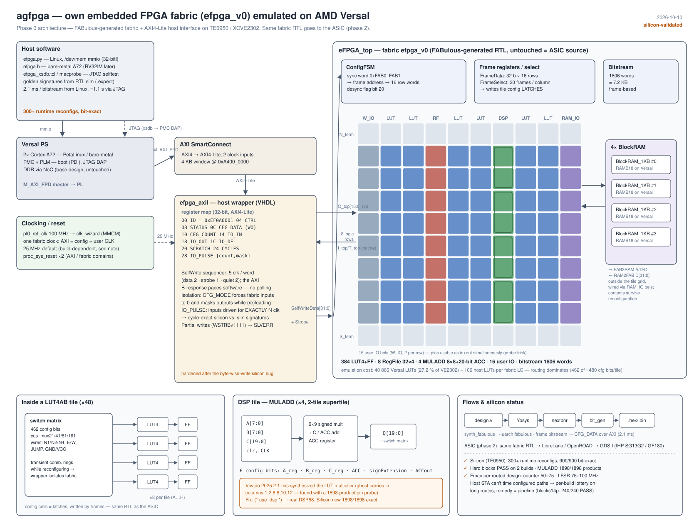

# agfpga — own eFPGA fabric, phase 0: emulation on Versal

Goal: an ASIC SoC (own RV32IM + IP cores + **own FPGA fabric**). Phase 0 builds the
fabric with [FABulous](https://github.com/FPGA-Research/FABulous) and runs it *inside*
the Versal (TE0950 / VE2302), reconfigurable at runtime from the PS (later: from the RV32IM).

```
 A72 (Linux / bare metal) ──M_AXI_FPD──► SmartConnect ──► efpga_axil (VHDL) ──SelfWrite──► eFPGA_top (FABulous)
                                                         │  CTRL/STATUS/CFG_DATA          8×10 tiles, 384 LUT4+FF
                                                         └─ IO_IN / IO_OUT / IO_PULSE ──► 16 IO bels
```


*(docs/architecture.svg — regenerate with `python3 docs/gen_architecture.py`)*

## Fabric `efpga_v0`

| Resource | Count |
|---|---|
| Tiles (incl. N/S terminators) | 10 × 10, 8 logic rows |
| LUT4 + FF (`LUT4AB`, 48 tiles × 8) | 384 |
| RegFile 32×4 | 8 |
| MULADD 8×8 + 20-bit acc | 4 |
| BlockRAM_1KB (RAM_IO) | 4 |
| User IOs (W_IO, 2 per row) | 16 |
| Bitstream | 1806 words / 7224 bytes |

Definition: `fabric/fabric.csv` (default FABulous tile set, cut to 8 rows).

## Status

| Check | Result |
|---|---|
| FABulous fabric generation | ✔ |
| User designs `counter14`, `lfsr14` (Yosys + nextpnr + bitgen) | ✔ |
| `tb_fabric_reconfig`: raw fabric, A→B→A runtime reconfig, golden model every clock | **PASS** |
| `tb_axil`: VHDL wrapper (GHDL→Verilog) + fabric, AXI4-Lite, isolation, CFG_COUNT, IO_PULSE exact | **PASS** |
| Negative test (wrong bitstream must be detected) | **PASS** |
| blocks14 golden RTL (MULADD + RegFile + BRAM), gap/pause invariant, each block mutation detected | **PASS** |
| blocks14 bitstream on the fabric vs golden (`tb_fabric_expect`) | see `sim/run_sim.sh` |
| `tb_axil`: partial writes (WSTRB≠1111) to CFG_DATA / IO_PULSE → SLVERR, not forwarded | **PASS** (old RTL fails it) |
| Vivado 2025.2.1 synth/impl/PDI for TE0950 (VE2302) | ✔ — see *Silicon results* |
| Silicon, JTAG (xsdb, `sw/efpga_xsdb.tcl`) | **PASS** — A→B→A ×3 |
| Silicon, Linux (A72, `/dev/mem`, `sw/efpga.py`) | **PASS** — 300 reconfigs, 900/900 bit-exact |
| Silicon, hard blocks (RegFile / BRAM / MULADD, DSP58 build) | **PASS** on 2 independent builds; MULADD 1898/1898 products |
| Silicon, combined pipelined design (blocks14p) | **PASS** on both builds, 240/240 checks incl. 40 × 16k-cycle runs |

Silicon signatures (`IO_PULSE`: reset 1 clk, enable n clks; identical in sim):

| design | n=1 | n=1000 | n=16383 |
|---|---|---|---|
| counter14 | 0x0001 | 0x03e8 | 0x3fff |
| lfsr14 | 0x0002 | 0x1cda | 0x0001 (full period) |

## Silicon results (2026-10-10, TE0950 / XCVE2302-1LP, fabric clock 25 MHz)

| Metric | Value |
|---|---|
| Vivado utilisation (fabric + wrapper) | 40 866 / 150 272 CLB LUTs (27.2 %), 42 593 regs (14.2 %), 4 RAMB18, 0 DSP |
| Cost of emulation | ~106 Versal LUTs per fabric LC (routing dominates: 462 of ~480 config bits per LUT4AB tile) |
| Timing outside the fabric | met, worst +0.246 ns (CIPS M_AXI_FPD → SmartConnect) |
| Timing through the fabric | WNS −6206 ns — structural, meaningless; validated empirically instead |
| Hold | met everywhere (WHS +0.015 ns) |
| Selftest from Linux | 300 runtime reconfigurations (counter14 → lfsr14 → counter14 ×100), 900/900 signatures bit-exact |
| Reconfiguration time | 2.1 ms per 7.2 KB bitstream from the A72 (~3.4 MB/s); hardware floor 0.36 ms (5 clk/word @25 MHz) — AXI round-trip latency bound |
| Fabric clock measured | 25.02 MHz (CYCLES register) |

### Clock sweep (2026-10-10, JTAG selftest, A→B→A ×3 per point)

| Fabric clock (measured) | counter14 | lfsr14 |
|---|---|---|
| 25.2 MHz | PASS | PASS |
| **50.5 MHz** | **PASS** | **PASS** |
| 75.9 MHz | FAIL — bits 9-13, value varies per run (carry chain) | PASS |
| 100.9 MHz | FAIL — already at n=1 | FAIL — bit 13 only |

Fmax is per routed design, as on any FPGA: counter14 50–75 MHz, lfsr14 75–100 MHz.
The nextpnr generic timing model (34 / 80 MHz) gets the ordering right but not the
absolute values. Default fabric clock for the emulation: **50 MHz**.
Every point met hold (WHS ≥ 0); WNS (≈ −6.3 µs) is structural and does not
depend on the clock.

### Hard blocks on silicon (2026-10-10, DSP58 build)

| Design | 25 MHz build | 15 MHz build |
|---|---|---|
| counter14, lfsr14 | PASS | PASS |
| blk_mac14 / blk_rf14 / blk_bram14 (one hard block each) | PASS incl. n=16383 | PASS incl. n=16383 |
| blk_macprobe (1898 silicon products vs a*b) | **1898/1898 PASS** | - |
| blocks14 (all three blocks + MISR, unpipelined) | fails ~40 % of 16k-cycle runs (~3e-5/cycle) | fails from n=37 (~7 %/cycle) |
| blocks14p (same, 2 pipeline stages before the MISR) | **PASS** (10 loops, 120 checks) | **PASS** (10 loops, 120 checks) |

blocks14's combined route (BRAM x=9 / DSP x=6 -> MISR) is the longest configured
path of the fabric. The host FPGA's STA cannot time bitstream-configured paths
(loops are broken arbitrarily), so that path's physical delay is a per-build
lottery and its failures look stochastic (delay is data-dependent; the MISR state
varies per cycle). This is a structural limit of emulating an FPGA inside an
FPGA - it does not exist in the ASIC flow, where the fabric is timed as a normal
netlist. The fix is the normal FPGA one: pipeline long user paths (blocks14p).

Open: configuration power during reconfiguration.

## Layout

```
fabric/                    FABulous project (generated RTL, untouched = ASIC source of truth)
designs/                   user designs for the fabric:
                             counter14.v, lfsr14.v  - LUT/FF only
                             blocks14.v             - MULADD + RegFile + BlockRAM #0 -> 14-bit MISR
rtl/efpga_axil.vhd         AXI4-Lite host interface (VHDL-93/2008 clean)
rtl/fpga/                  FPGA model of the sky130 OpenRAM macro used by BlockRAM_1KB
scripts/compile_user_design.sh   design.v -> build/bitstreams/{bin,hex,h}
scripts/prepare_sources.sh       fabric -> build/src/{fpga.f,sim.f}
scripts/bin2words.py             .bin -> hex words / C array
scripts/patch_wrapper.py         connects io_* and bram0_* ports in FABulous' top_wrapper.v
sim/run_sim.sh             full regression (iverilog + GHDL); QUICK=1 skips the slow blocks14 fabric sim
sim/tb_golden_blocks14.v   golden RTL model of blocks14 -> build/bitstreams/blocks14.expect
sim/tb_fabric_expect.v     any bitstream on the raw fabric vs an .expect file
vivado/add_efpga_to_bd.tcl add the subsystem to an OPEN Versal BD (CIPS untouched)
vivado/build_te0950.tcl    base .xpr -> copy -> +eFPGA -> PDI + XSA + reports
vivado/efpga.xdc           LUTLP-1 downgrade + ALLOW_COMBINATORIAL_LOOPS (fabric only)
sw/efpga.py                PetaLinux /dev/mem tool: info / load / selftest
sw/efpga_xsdb.tcl          same selftest over JTAG (programs the PDI, no Linux needed)
sw/efpga.h                 bare-metal driver (A72 now, RV32IM later)
```

## Register map (`efpga_axil`, 4 KB)

| Off | Name | Access | Description |
|---|---|---|---|
| 0x00 | ID | RO | `0xEF0A0001` |
| 0x04 | CTRL | RW | [0] CFG_MODE (isolate fabric, reset value 1), [1] CFG_RESET (pulse), [2] IN_SEL (0 = IO_IN, 1 = pin_i) |
| 0x08 | STATUS | RO | [0] CFG_BUSY, [1] CFG_MODE, [2] IN_SEL, [3] PULSE_BUSY |
| 0x0C | CFG_DATA | WO | one bitstream word; B response held until the 5-clk SelfWrite sequence ends. Full 32-bit writes only, partial → SLVERR |
| 0x10 | CFG_COUNT | RO | words since CFG_RESET |
| 0x14 | IO_IN | RW | [15:0] fabric inputs |
| 0x18 | IO_OUT | RO | [15:0] fabric outputs (0 while CFG_MODE) |
| 0x1C | IO_OE | RO | [15:0] 1 = fabric drives the pin |
| 0x20 | SCRATCH | RW | |
| 0x24 | CYCLES | RO | free-running fabric clock counter |
| 0x28 | IO_PULSE | RW | write `{COUNT[31:16], MASK[15:0]}`: inputs = IO_IN\|MASK for exactly COUNT clocks. Full 32-bit writes only, partial → SLVERR |

## Flow

```bash
# toolchain (tested): FABulous 2.2.0 (python 3.12 venv), yosys 0.66 (!), nextpnr-generic
# (git 861c57b, --uarch fabulous), iverilog 12, GHDL 4.1
scripts/compile_user_design.sh designs/counter14.v
scripts/compile_user_design.sh designs/lfsr14.v
sim/run_sim.sh                                   # ~4 min, ends with REGRESSION: PASS

# Vivado 2025.2.1 - ALWAYS through ./vivado.sh (strips the venv from PATH, see issue 7)
./vivado.sh -mode gui -source vivado/create_project_te0950.tcl   # empty project + CIPS
#   GUI: configure CIPS (M_AXI_FPD, PL0 100 MHz, 1 PL reset, NoC/DDR for Linux)
#   Tcl: source vivado/add_efpga_to_bd.tcl ; wrapper ; impl ; write_device_image
# or, from an existing working base project:
./vivado.sh -mode batch -source vivado/build_te0950.tcl -tclargs /path/base.xpr 25 4

# silicon over JTAG (no Linux): <pdi> <base> <loops> <designs...> (d1 -> d2 -> ... -> d1)
xsdb sw/efpga_xsdb.tcl build/vivado/efpga_te0950_50MHz.pdi 0xA4000000 3 \
     build/bitstreams/counter14.hex build/bitstreams/lfsr14.hex build/bitstreams/blocks14.hex

# silicon from PetaLinux (root; paste ONE command per line over UART)
python3 efpga.py --base 0xA4000000 info
python3 efpga.py --base 0xA4000000 selftest counter14.hex lfsr14.hex blocks14.hex --loops 100
#   (blocks14.expect must sit next to blocks14.hex)
```

`add_efpga_to_bd.tcl` expects `M_AXI_FPD` and `pl0_ref_clk/pl0_resetn` on the CIPS. If
they are not enabled, it stops and tells you — enable them in the CIPS GUI. It adds an MMCM
(25 MHz), a reset block, a SmartConnect (or one MI on the existing SmartConnect), the
wrapper and assigns the address.

## Known issues / risks (honest list)

1. **Transient combinational rings during reconfiguration.** While frames of design A and B
   are mixed, switch matrices can close loops. Zero-delay simulation hangs (sim models get a
   0.2 ns mux delay); in silicon they oscillate until the breaking frame is written. The
   wrapper isolates the fabric (CFG_MODE) and user logic must be reset after loading. For the
   ASIC this also means extra dynamic power during configuration — worth measuring.
2. **Vivado STA is meaningless inside the fabric.** It times structural paths through
   unconfigured routing. Expect negative slack inside `u_efpga`; only wrapper↔fabric
   boundary paths are real. The fabric is validated empirically: selftest at 25 MHz, then
   sweep the clock (rebuild with `freq_mhz`) to find the real margin.
3. **Config cells are latches** (`config_latch`, same RTL as the ASIC). In Vivado they
   become LDCE gated by a decode of registered signals. **Silicon: 300 reconfigurations
   without a single failure** — keep as the first suspect if a future config fails.
4. **Vivado trims ~38k of ~79k config latches** whose outputs cannot reach any observable
   net (open `A/B_config_C` ports, unloaded branches). Safe by construction (no bitstream can
   observe them), but the emulation is not a 1:1 area model of the ASIC.
5. **Untested in this phase:** BRAM (FPGA model infers RAMB18), MULADD (mapped to LUTs,
   not DSP58), RegFile — no user design exercises them yet.
6. **Toolchain pinning:** yosys ≥ 0.67 dropped `share/fabulous` → compile fails with
   "IO_1_bidirectional_frame_config_pass is not part of the design". Use 0.66.
   FABulous project default PDK is IHP SG13G2; removed in `.FABulous/.env` for RTL work.

7. **Vivado 2025.2.1 functionally mis-synthesizes the fabric's MULADD** (second
   silicon-confirmed synthesis bug on this version, after the indexed-VHDL-function
   one). Evidence: blk_mac14/blocks14 wrong on silicon while counter/LFSR/RegFile/BRAM
   pass; results identical at 10/25/50 MHz (not timing); the same bitstream is correct
   in RTL simulation; blk_macprobe shows the silicon result is a (corrupted) function
   of the true product alone - carry corruption at adder columns 1,2,6,8,10,12 plus an
   operand-dependent output bit 5. Mitigation in prepare_sources.sh: `use_dsp` +
   `keep_hierarchy` on MULADD (DSP58 mapping). Verify with blk_macprobe after rebuild.
8. **Never launch Vivado from a shell with the FABulous venv active.** Lopper (PLM
   generation in `write_device_image`) picks up `.venv/bin/pcpp`, which dies under Vivado's
   `PYTHONHOME` ("No module named 'encodings'"). `./vivado.sh` strips it from PATH.
9. **Python register access must be 32-bit.** `struct.pack_into("<I", mmap, ...)` writes
   byte by byte → 4+ AXI writes per word; the old wrapper counted each one (CFG_COUNT
   = 5 × 1806 on silicon). Fixed twice: `efpga.py` uses `memoryview.cast("I")`, and the
   wrapper now rejects partial CFG_DATA / IO_PULSE writes with SLVERR.
10. **Disk space:** a fresh PetaLinux project needs 60–100 GB; keep it on `/data`.

## User designs with hard blocks

A user design is `module <name>(clk, io_in[15:0], io_out[15:0], io_oeb[15:0])`.
MULADD and RegFile_32x4 are instantiated directly (bit-level ports as in yosys'
`share/fabulous/prims.v`, configuration through parameters). BlockRAM #0 is reached by
declaring these extra ports; `scripts/patch_wrapper.py` wires them to the RAM_IO bels:

```verilog
output [7:0]  bram0_rd_addr, bram0_wr_addr,
output [31:0] bram0_wr_data,   // [20] = write enable (active high)
output [5:0]  bram0_cfg,       // C0..C5, all 0 = 32-bit ports, no extra register
input  [31:0] bram0_rd_data    // synchronous read, 1 cycle
```

Pitfalls found while writing blocks14 (all caught by `tb_golden_blocks14`):
- MULADD has no clock enable: force the operands to 0 when the design is paused.
- BRAM and RegFile keep their contents across reconfigurations: mask reads of
  addresses not yet written since reset.
- The BRAM read is synchronous; during a pause the address must stay the one of
  the last active cycle, or the result depends on the pause length.

## ASIC timing on IHP SG13G2 (structural, 2026-10-10)

First real-silicon-process Fmax numbers for the fabric, from the FABulous 2.2
`timing_model` flow: every tile is synthesized to SG13G2 standard cells
(yosys + liberty), OpenSTA extracts per-pip delays from the resulting SDF, and
nextpnr then places & routes timing-driven against that model. Bel-internal
arcs (LUT, FF, carry) were measured separately with OpenSTA on the
yosys-mapped `LUT4c_frame_config_dffesr` bel and fed into
`gen_npnr_model.py`. Setup: `scripts/asic_timing_setup.sh <ihp-open-pdk> [typ|slow]`
(builds required: native yosys 0.66 — the venv's yowasp wrapper cannot run
this flow — and OpenSTA; see the script header).

nextpnr-reported Fmax, same netlists as the Versal campaign:

| design    | Versal emulated (silicon) | SG13G2 typ, structural | SG13G2 slow, structural | SG13G2 slow, physical, no_opt (6.10 mm2) | **SG13G2 slow, physical, optimised (3.62 mm2)** |
|-----------|---------------------------|------------------------|-------------------------|------------------------------------------|--------------------------------------------------|
| counter14 | 50.5 pass / 75.9 fail     | 185.9 MHz              | 127.6 MHz               | 56.1 MHz                                 | **56.05 MHz**                                    |
| lfsr14    | 75.9 pass / 100.9 fail    | 342.5 MHz              | 242.7 MHz               | 123.2 MHz                                | **123.15 MHz**                                   |
| blocks14p | ≥25 (not swept)           | 267.4 MHz              | 186.6 MHz               | 74.9 MHz                                 | **69.64 MHz**                                    |

Honest limits of these numbers:

- **Structural = no wire parasitics.** Pip delays are cell delays only
  (SDF INTERCONNECT entries are 0). Post-layout (physical mode, after
  `gen_fabric_macro` + LibreLane/OpenROAD, with SPEF) will be slower,
  plausibly 20–40 % on routing-heavy paths. Treat these as upper bounds.
- MULADD, RegFile and BRAM bels have **no timing arcs yet** — paths through
  their internals are untimed. blk_mac14's multiplier path is not covered.
- Clock tree is ideal (constant arrival, zero skew); nextpnr's report is not
  sign-off STA.
- Two upstream bugs had to be patched to get here (handled by the setup
  script): the `sdf_timing` lexer rejects `$` in escaped instance names, and
  the fabulous timing tools crash while *reporting* a failed subprocess
  (str.join over PosixPath), masking the real error underneath.

**Physical column (2026-10-11):** `timing_model --mode physical` on the hardened
fabric - per-tile post-route netlists + SPEF (RC-extracted), slow-corner
liberty, inter-tile abutment delays (~1 ps). Real wires cost **50-60 %** of the
structural numbers, far more than the 20-40 % predicted. Remaining caveats:
bel-internal LUT/FF/carry arcs are still the pre-layout OpenSTA values,
MULADD/RegFile/BRAM internals have no arcs, the clock tree is ideal, and this
is the worst corner (structural typ/slow ratio was ~1.45, so typical silicon
should land around 80 / 175 / 110 MHz).

**Optimised column (2026-10-12):** same flow on the area-optimised fabric
(below). All 101k pip delays changed (new SPEF from `final_views`), yet
counter14/lfsr14 are unchanged within 0.05 MHz: their critical paths are
dominated by the bel-internal carry and LUT->FF arcs, which are the fixed
pre-layout values. blocks14p loses 7 %. So shrinking the tiles did NOT buy
speed (shorter switch-matrix wires are offset by the ~96 % utilisation), but
it cost almost none either: **-41 % area for 0 / 0 / -7 % Fmax.** Until the
bel arcs are re-extracted from the hardened LUT4AB, the first two numbers are
only as good as those pre-layout arcs.

Conclusion: worst-case user-logic Fmax on the 130 nm fabric is **55-125 MHz**
for these designs, ~110-175 MHz typical. Notably the worst-case ASIC numbers
land in the same range as the Versal emulation (which was limited for an
entirely different reason - untimed emulated routing hops). A 300 MHz user
clock is out of reach at 130 nm. Smaller tiles (`--optimise`) turned out not
to be a speed lever (see the optimised column); what remains is stronger
drivers on long wires, bel arcs from the hardened layout, and pipelined user
designs.

## GDS hardening flow (FABulous -> LibreLane, IHP SG13G2)

`scripts/asic_gds_setup.sh` prepares the full RTL-to-GDS flow (run it, install
whatever it flags as missing, re-run). Three facts worth knowing before the
first run, all discovered the hard way:

- **LibreLane is installed via pip, not nix**, so the PnR tools come from the
  system: verilator/klayout/magic from apt, netgen built from source, openroad
  from the prebuilt .deb (Precision-Innovations GitHub releases), and
  `pip install pyosys` inside the venv.
- LibreLane's synthesis steps invoke **`yosys -y` (python-enabled yosys)**,
  which neither the venv's yowasp wrapper nor a stock yosys build supports.
  `scripts/yosys-pyosys` shims those calls onto the pyosys wheel; the
  `_LLN_OVERRIDE_YOSYS` env var (exported from env.sh, NOT in `.FABulous/.env`,
  whose schema rejects unknown keys) points LibreLane at it.
- The PDK resolves itself: `FAB_PDK=ihp-sg13g2` in `fabric/.FABulous/.env` and
  FABulous/ciel download the recommended build (~1 GB) to `~/.ciel` on first
  use. The IHP PDK ships its own LibreLane tech files, including the config
  latch map and tribuf map, so the fabric's config latches synthesize to
  `sg13g2_dlhq_1` with no custom techmap.

**First tile hardened (2026-10-10): LUT4AB -> GDS on IHP SG13G2.**
KLayout DRC, antenna and Netgen LVS all pass ("Circuits match uniquely":
2071 devices / 2197 nets). Die 246.24 x 245.28 um = **0.0604 mm2** (no_opt,
the size FABulous' tile config fixes; `--optimise` can shrink it). Cell mix:
616 `sg13g2_dlhq_1` config latches, 252 mux4 + 112 mux2 (switch matrix),
8 flops, 126 antenna diodes inserted by the post-route repair. Flow time on a
32-thread workstation: ~2 min. Caveats: Magic DRC was skipped by the flow's
condition and the post-PnR setup/hold/slew checkers found no metrics, so
timing sign-off still has to come from the physical timing model.

**Full fabric (2026-10-11): all 13 tile types hardened (each DRC/LVS/antenna
clean) and stitched by `gen_fabric_macro` into `Fabric/macro/final_views/gds/eFPGA.gds`
(26 MB): 2483.0 x 2455.3 um = **6.10 mm2** in IHP SG13G2, DRC clean. The four
BlockRAMs sit outside eFPGA_top and are not included (they still point at the
sky130 OpenRAM model; IHP needs the PDK's sg13g2_sram macros). The 20 N/S
terminator tiles are full-size in no_opt mode - ~1.2 mm2, a fifth of the
fabric - so `--optimise` on them is the first area lever (4.5-5 mm2 looks
realistic).

**Area-optimised fabric (2026-10-12, current reference):**
`run_FABulous_eFPGA_macro` explores three modes per tile (balance,
find_min_width, find_min_height; pymoo NLP), re-hardens the winners and
re-stitches: **1917.1 x 1889.2 um = 3.62 mm2, -41 %** vs no_opt (the
terminators were the expected lever, the logic tiles shrank too: LUT4AB
216.96 x 209.58 um at 96.3 % utilisation). DRC and LVS pass. Modes that found
no legal state for a tile (e.g. N_term_single balance, DSP min_width) are
simply excluded by the optimiser. The no_opt fabric is archived outside the
repo; Fmax and LEC results for both are in the timing and verification
sections.

Getting there took eight toolchain fixes on Ubuntu 24.04 - all now encoded in
`scripts/asic_gds_setup.sh` (header lists them) and the IHP sections of
`fabric/Tile/*/gds_config.yaml`: pyosys shim, OpenROAD CMake build with
`-python`, PYTHONPATH for openroad's embedded interpreter, magic/netgen from
source (netgen after tcl-dev), official KLayout .deb, and three OpenROAD-master
vs LibreLane-3.0.16 incompatibilities (CTS latency balancing, `getArea()` in
DBU^2 giving 360 mm pins, port diodes on UserCLKo).

The run order:

```sh
cd fabric
FABulous -p . run "load_fabric; gen_tile_macro LUT4AB"   # one tile first
FABulous -p . run "load_fabric; gen_all_tile_macros"     # the rest (hours)
FABulous -p . run "load_fabric; gen_fabric_macro"        # stitch the fabric
FABulous -p . run "load_fabric; timing_model --mode physical"  # sign-off-grade pips
```

Outputs: `Tile/<T>/macro/final_views/{gds,lef,nl,spef}` per tile,
`Fabric/macro/` + `gds/` for the stitched fabric — the area number comes from
the fabric DIE_AREA, and physical mode replaces the structural timing model
with parasitic-aware delays.

## Verifying the hardened fabric

Status 2026-10-12, real post-route netlists of the area-optimised fabric
(the no_opt fabric of 2026-10-11 gave the same picture):

| check | scope | result |
|---|---|---|
| Netgen LVS (GDS flow) | layout == post-route netlist, all 13 tiles | clean |
| LEC `scripts/lec_tiles.sh` | post-route == **RTL**, every configuration | **12/13 tiles proven** (incl. RegFile with loop cut points) |
| LEC `LEC_GOLD=synth` | post-route == LibreLane synthesis | no_opt: DSP proven (17144/0), RegFile proven (9407/0); optimised: DSP re-run with native yosys (yowasp runs out of its 4 GB WASM heap) |
| gate-level sim `sim/run_gl.sh` | 3 bitstreams on the stitched netlist | blocked by X/loop semantics, not a design fault (see below) |

Chain: RTL (silicon-validated on Versal) == netlist (LEC) == layout (LVS) == GDS
(DRC clean). The one link not formally closed: the DSP's RTL == synthesis
(its 8x8 multiplier cone does not close in equiv_simple); it rests on yosys'
synthesis correctness plus the silicon-validated MULADD behaviour.

Two lessons from getting there:
- **Name pairing**: the router writes memory flops as `\mem[31][0]`, yosys'
  memory pass as `\mem[31] [0]` - `splitnets` on both sides fixes it.
- **Configurable combinational loops**: RegFile's read data (AD/BD) can be
  routed back into its own read address, closing a loop through the memory
  read. A loop has no unique value, SAT picks different fixed points on the
  two sides, and the LEC reports a spurious mismatch (729/168). Found by a
  combinational miter + `scc` on the RTL; cutting AD/BD on both sides gives
  897/0 - equivalence for every loop-free configuration, i.e. every one
  nextpnr can produce. The same loops are why the gate-level simulation
  stalls once the X-scrub gives them defined values.
- Gate-level sim: with FABulous' X-scrub outputs stay X (pessimistic gates
  keep X in unused in-tile routing); with `GL_SCRUB=full` the simulator stalls
  at the scrub instant (configurable loops come alive). Kept as tooling.

## BlockRAM on IHP silicon

`rtl/asic/ihp/sram_1rw1r_32_256_8_sky130.v` maps the sky130 OpenRAM interface
that FABulous' BlockRAM_1KB instantiates onto the IHP true dual-port macro
`RM_IHPSG13_2P_256x32_c2_bm_bist` (256x32, bit mask, 702.83 x 136.97 um,
clk-to-q 3.1 ns typ / 5.3 ns slow): port A write, port B read, A/B_DLY tied 1
(mandatory), BIST tied off. `sim/run_sram_ihp.sh`: 15k random reads vs the
FPGA model, 0 mismatches; a swapped byte-mask lane is caught. Silicon
constraint (IHP datasheet: "no conflict handling"): reading the address being
written in the same cycle returns undefined data - user designs must avoid it.
ASIC builds only; the Vivado/RTL flows keep rtl/fpga.

## eFPGA_top hardened on IHP SG13G2 (2026-10-12)

The complete reconfigurable block - config logic (UART/bitbang, ConfigFSM,
Frame_Data_Reg x8, Frame_Select x10), the area-optimised eFPGA macro and the
four BlockRAMs, each on an IHP `RM_IHPSG13_2P_256x32` SRAM - hardened as one
LibreLane run:

```sh
python3 scripts/gen_top_config.py          # writes build/top/{config.yaml,pdn_top.tcl,pin_order.cfg,src/}
echo "RUN_MAGIC_DRC: false" >> build/top/config.yaml   # see below
cd build/top && librelane --pdk ihp-sg13g2 config.yaml
```

| | result |
|---|---|
| die | 2813 x 1999 um = **5.62 mm2** (eFPGA 3.62 + 4 SRAM 0.38 + config/BRAM logic, routing) |
| KLayout DRC (IHP precheck mode) | **0** |
| Netgen LVS (macros as black boxes) | **clean** |
| antenna | clean |
| setup / hold @ 20 ns, 3 corners | +4.33 ns (slow) / +0.25 ns (fast) |
| max slew / max cap (slow corner) | 21 / 3 remaining - SRAM inputs A_BM (16, up to 0.74 ns) and A_DIN (3, up to 0.97 ns) vs 0.595 ns, the end of the SRAM liberty tables: **open** |

Floorplan (`gen_top_config.py`, everything derived from the LEFs): eFPGA at
the lower left, the SRAMs in a column to its east, each top-aligned with its
RAM_IO tile pair (BlockRAM k <-> tiles X9Y(8-2k)/X9Y(7-2k)) so its south-edge
pins face a channel at the height of the fabric's RAM ports. Top-level PDN
TopMetal1/TopMetal2: the eFPGA has VPWR/VGND only on TopMetal1 (OBS up to
TopMetal1), so TopMetal2 straps cross it; the SRAM's Metal4 VDD!/VDDARRAY!/VSS!
get their own macro grid (TopMetal2 -> Metal4, `pdn_top.tcl`).

What it took (each one cost at least one full run - all encoded in the
generator with the reason next to the setting):
- **360 mm IO pins** - the same OpenROAD-master `getArea()` DBU^2 bug as in the
  tiles, now in LibreLane's own IO placer: 183 pins crossing the die, 28k
  global-routing overflow, 9k DRT violations after 6 h. `IO_PIN_*_LENGTH: 0.36`.
- **PDN-0179 channels** next to the SRAMs: rows are cut at the 10 um macro
  halo, the stdcell grid stops at the PDN halo (also 10 um) -> the rows touching
  a SRAM had no TopMetal1 strap of one net. PDN halo 0 (`scripts/pdn_probe.sh`
  isolated it in four 1-minute runs).
- **Strip widths**: a strip of rows must be row-free (< 2 x 10 um halo) or
  >= 104 um so it always contains a full VPWR/VGND strap pair (pitch 75.6 um).
  An 18 um routing-only gap overflowed (all RAM and Config_accessC nets squeeze
  through it); 105 um closes.
- **DRC markers are in local cell coordinates** (KLayout deep mode). Full-mode
  DRC reported 4172 markers - `scripts/drc_marker_cells.py` shows they are all
  inside the PDK's SRAM GDS (Sdiod.d/e in COLDEC2/ROWREG6/..., Cnt.c.digibnd in
  the BITKIT cells), rules the deck itself disables in precheck mode. Magic DRC
  (3.1 M "errors", same cells) is switched off; KLayout is IHP's sign-off deck.
- Hold (71 violations, -0.39 ns fast) and slew (279) needed the post-GRT
  resizer and repair passes with larger margins: the pre-route estimate misses
  the long SRAM-edge wires and the 2.8 mm clock tree.

Not covered yet: the eFPGA has no liberty, so paths into/out of the fabric are
untimed at this level; metal density/fill is checked on the full chip
(padring) later; the 21 SRAM-input slews above (279 -> 35 -> 21 with growing
repair margins; the rest needs a structural fix - per-pin drivers next to the
SRAM edge or more free rows under it - not more margin).

## Next steps

- ~~Phase 0b: Vivado + silicon on TE0950~~ ✔ (2026-10-10). Remaining: clock sweep
  (50/75/100 MHz), power during reconfiguration, FIFO/DMA config path (2.1 → ~0.4 ms).
- User designs exercising BRAM, MULADD, RegFile.
- CPU_IO tile so the RV32IM sees the fabric as a bus peripheral / custom instruction unit.
- Phase 1: RV32IM + peripherals + eFPGA SoC in emulation; Phase 2: fabric sized for
  GF180 (wafer.space) or IHP SG13G2, LibreLane flow, latch-map tech file.
